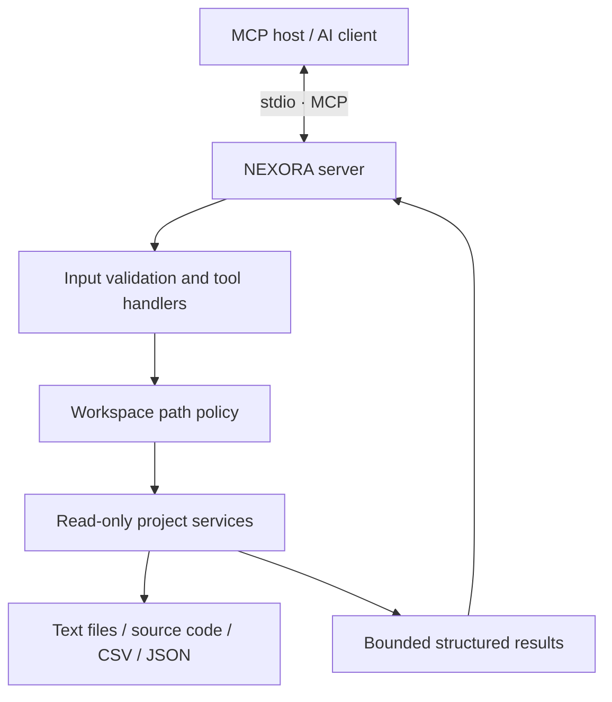

# NEXORA Core

[](https://github.com/Ashutosh197884/NEXORA_1.0/actions/workflows/ci.yml)

**Local-first MCP tools for developers.** NEXORA gives AI clients a small, security-minded set of read-only tools for understanding a project workspace.

> **Repository description:** A local-first, security-minded MCP server for developer workflows: workspace file listing, bounded file reading, code search, and CSV/JSON inspection.

[Architecture](docs/architecture.md) · [Development workflow](docs/development-workflow.md) · [Implementation plan](docs/implementation-plan.md) · [Security policy](SECURITY.md) · [Contributing](CONTRIBUTING.md)

## Why NEXORA?

Developers often need AI assistants to inspect a repository or understand a data file without granting them unrestricted shell access. NEXORA exposes a focused set of read-only capabilities through the Model Context Protocol (MCP), while keeping the workspace boundary explicit.

### v0.1 capabilities

| Tool | Purpose |
| --- | --- |
| `list_project_files` | List files and directories under the configured workspace |
| `read_project_file` | Read a bounded UTF-8 text file |
| `search_project_code` | Find a literal, case-insensitive query in supported text files |
| `inspect_data_file` | Inspect CSV/JSON structure and summarize numeric fields |

## Project principles

- **Local-first:** the default transport is stdio; NEXORA does not open a network listener by default.
- **Read-only by design:** no arbitrary shell execution or file mutation tools.
- **Workspace-scoped:** tool paths are relative to `NEXORA_WORKSPACE`; absolute paths, traversal, and symlink escapes are rejected.
- **Bounded:** file sizes, search sizes, and result counts have configurable limits.
- **Remote-ready, not remotely exposed:** a future Streamable HTTP deployment must add authentication and operational security controls before exposure.
- **Open source:** Apache License 2.0.

## Requirements

- Python 3.11 or newer
- [uv](https://docs.astral.sh/uv/)
- Node.js and `npx` only if you want to use MCP Inspector through the SDK CLI

## Quick start

Clone the repository and install the package with its development dependencies:

```bash
git clone https://github.com/Ashutosh197884/NEXORA_1.0.git
cd NEXORA_1.0
uv sync --extra dev
```

Choose the directory the MCP server is allowed to inspect, then start it:

```bash
# macOS/Linux
export NEXORA_WORKSPACE="$PWD"
uv run nexora-mcp
```

On Windows PowerShell:

```powershell
$env:NEXORA_WORKSPACE = (Get-Location).Path
uv run nexora-mcp
```

The server uses stdio for MCP protocol traffic. When an MCP host launches NEXORA, configure it to run the `nexora-mcp` executable with the desired workspace environment variable. Do not print debugging messages to stdout in stdio mode.

## Configuration

| Environment variable | Default | Description |
| --- | --- | --- |
| `NEXORA_WORKSPACE` | `.` | Existing directory that defines the allowed workspace |
| `NEXORA_MAX_READ_BYTES` | `1048576` | Maximum file size for `read_project_file` |
| `NEXORA_MAX_INSPECT_BYTES` | `10485760` | Maximum CSV/JSON file size for `inspect_data_file` |
| `NEXORA_MAX_SEARCH_RESULTS` | `100` | Maximum number of search matches returned |
| `NEXORA_MAX_SEARCH_FILE_BYTES` | `1048576` | Files larger than this are skipped during search |
| `NEXORA_LOG_LEVEL` | `INFO` | Logging level: DEBUG, INFO, WARNING, ERROR, or CRITICAL |

A sample environment file is available at [`.env.example`](.env.example). The application currently reads environment variables directly; it does not automatically load a `.env` file.

## Development

Run the test suite and lint checks:

```bash
uv run pytest
uv run ruff check .
```

Launch the MCP Inspector:

```bash
uv run mcp dev src/nexora/server.py
```

The GitHub Actions workflow runs lint and tests on pushes and pull requests. See [Development workflow](docs/development-workflow.md) for the expected change lifecycle and [Architecture](docs/architecture.md) for the component boundaries.

## Architecture at a glance



The MCP SDK owns protocol handling. NEXORA's service layer handles project inspection, while the path policy enforces the workspace boundary. See [docs/architecture.md](docs/architecture.md) for the full design and trust boundaries.

## Roadmap

- [x] Local stdio MCP server foundation
- [x] Four read-only developer tools
- [x] Workspace path validation and bounded reads
- [x] Unit and security tests
- [x] CI workflow and project documentation
- [x] Verify dependency resolution, lint, and tests in clean GitHub Actions environments on Python 3.11, 3.12, and 3.13
- [x] Exercise MCP tool discovery and stdio invocation through automated integration tests
- [ ] Optional manual MCP Inspector walkthrough for UI-based review
- [ ] Add a tested, authenticated Streamable HTTP deployment path in a future release

## License

Licensed under the [Apache License 2.0](LICENSE).
