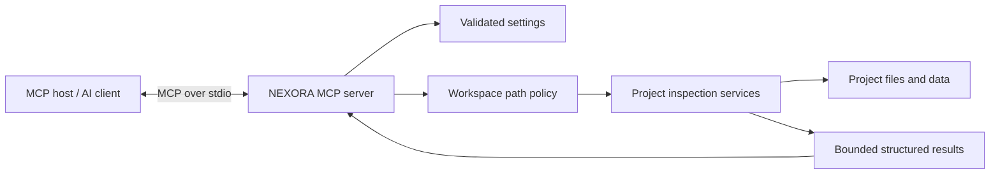

# NEXORA Core Architecture

**Status:** v0.1 foundation  
**Primary audience:** developers integrating MCP tools into their AI workflows  
**Deployment model:** local-first, stdio by default; remote transport is a future capability

## 1. System overview

NEXORA is a Model Context Protocol (MCP) server that exposes a deliberately small, read-only interface to a configured project workspace. It does not execute arbitrary commands or modify workspace files.

## 2. Runtime request flow

1. The MCP host launches the `nexora-mcp` entry point as a local subprocess.
2. The official MCP Python SDK handles protocol framing, negotiation, tool discovery, and invocation.
3. A tool handler validates arguments and calls the project service.
4. The path policy resolves the requested relative path and rejects paths outside the configured workspace.
5. The service checks file type and size, then performs a read-only operation.
6. The result is returned through the MCP SDK. Logs go to stderr; stdout is reserved for stdio protocol messages.

## 3. Component responsibilities

| Component | Responsibility |
| --- | --- |
| `src/nexora/server.py` | MCP server construction, tool registration, and process entry point |
| `src/nexora/config.py` | Environment-backed configuration, positive integer limits, and log-level validation |
| `src/nexora/policies/paths.py` | Canonical path resolution and workspace-boundary enforcement |
| `src/nexora/services/project_service.py` | File listing, text reading, literal code search, and CSV/JSON inspection |
| `tests/unit/` | Expected service behavior and invalid input |
| `tests/security/` | Traversal, symlink escape, and malformed path cases |
| `tests/integration/` | MCP tool discovery and server-level integration |

## 4. Tool contracts

### `list_project_files(path=".")`

Lists entries in a workspace-relative directory. It skips entries whose resolved targets escape the workspace and caps the number of entries returned.

### `read_project_file(path)`

Reads a supported UTF-8 text file. Absolute paths and paths outside the workspace are rejected; file type and maximum byte size are checked before reading.

### `search_project_code(query, path=".")`

Searches supported text files for a literal, case-insensitive string. It skips files that exceed the configured per-file scan limit and caps the number of returned matches. It is not a regular-expression or semantic search engine.

### `inspect_data_file(path)`

Inspects CSV and JSON files. CSV results include columns, record counts, and numeric summaries; JSON results describe the top-level type, keys, and supported record summaries. Input size and sampled rows are bounded.

## 5. Configuration and policy

The workspace root is selected through `NEXORA_WORKSPACE` and resolved before requests are served. Tool paths must be relative. Canonical path checks prevent `..` traversal and symlink escapes.

Configurable limits are applied to reads, data inspection, search file size, and search results. These limits reduce accidental over-reading and oversized responses; they are not a replacement for OS-level sandboxing.

## 6. Trust boundaries and threat model

Treat both MCP callers and files inside the workspace as untrusted.

| Threat | Current mitigation | Remaining consideration |
| --- | --- | --- |
| Absolute path or parent traversal | Reject absolute paths; resolve canonical paths under the workspace | Add broader adversarial path tests for supported operating systems |
| Symlink escape | Resolve symlinks and verify the target remains under the workspace | Filesystem race conditions require OS sandboxing for stronger isolation |
| Very large file or response | Configurable byte limits and result caps | Tune limits for each deployment and host |
| Malformed or binary content | UTF-8 validation and supported extension allowlist for file reads | Add more explicit content-type detection if supported formats expand |
| Prompt injection inside source/data files | Tool descriptions and policy state that file contents are untrusted data | The consuming model/host must also treat returned content as data, not authority |
| Accidental command execution or mutation | No shell-execution or write tools are registered | Preserve this constraint unless a separate threat model is approved |
| Network exposure | stdio is the default; no network listener is started by the normal entry point | Do not expose remote transport until authentication and deployment hardening exist |

NEXORA grants the connected AI client read access to the configured workspace. Operators should choose that directory deliberately and use a separate OS account or container for higher-risk projects.

## 7. Local deployment

The default process is launched by an MCP host over stdio. No port needs to be opened. Docker is provided as an optional packaging route; mount only the intended project directory at `/workspace` and set `NEXORA_WORKSPACE=/workspace`.

## 8. Remote-ready evolution

The service layer is intentionally separated from the transport layer so future transport work can reuse the project inspection logic. A future Streamable HTTP mode must not be treated as production-ready merely because the SDK supports it.

Before remote exposure, implement and test at least:

- authentication and per-client authorization;
- HTTPS termination and secret management;
- host/origin validation and safe CORS policy where applicable;
- request, concurrency, and response-size limits;
- structured audit logging without leaking file contents or secrets;
- deployment isolation, health checks, and dependency scanning;
- an explicit decision about which workspace each identity may access.

Remote transport remains out of scope for the v0.1 default configuration.
