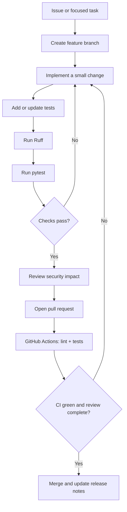

# Development Workflow

This document describes the expected lifecycle for changes to NEXORA Core. It is a project workflow, not a claim that every release gate has already passed.

## Change lifecycle



## Local checks

Install development dependencies:

```bash
uv sync --extra dev
```

Run lint and tests:

```bash
uv run ruff check .
uv run pytest
```

For protocol-level manual testing, run:

```bash
uv run mcp dev src/nexora/server.py
```

Use MCP Inspector to discover the four tools and try valid inputs and rejected paths. Confirm that the server does not print non-protocol output to stdout in stdio mode.

## Continuous integration

The workflow in `.github/workflows/ci.yml` runs on pushes and pull requests across Python 3.11, 3.12, and 3.13. It installs the project and development dependencies, runs Ruff, and runs pytest.

CI is the automated baseline, not a substitute for manual MCP Inspector verification or review of path-security changes.

## Review checklist

- [ ] Tool inputs are validated and have clear descriptions.
- [ ] New file access stays within `NEXORA_WORKSPACE`.
- [ ] File reads and responses remain bounded.
- [ ] No arbitrary shell execution or file mutation was introduced.
- [ ] Tests cover normal behavior, invalid input, and security boundaries.
- [ ] Logs do not contain secrets or full file contents.
- [ ] Documentation and configuration examples match the implementation.
- [ ] Any new dependency is justified and constrained.
